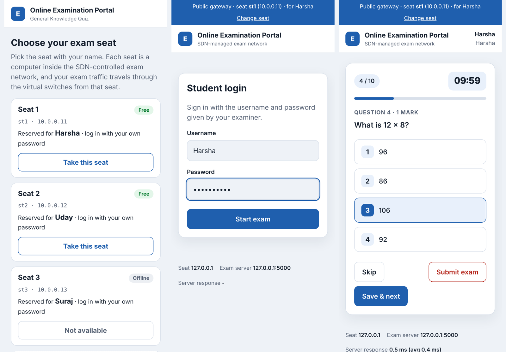
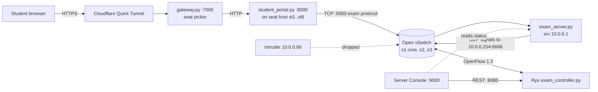
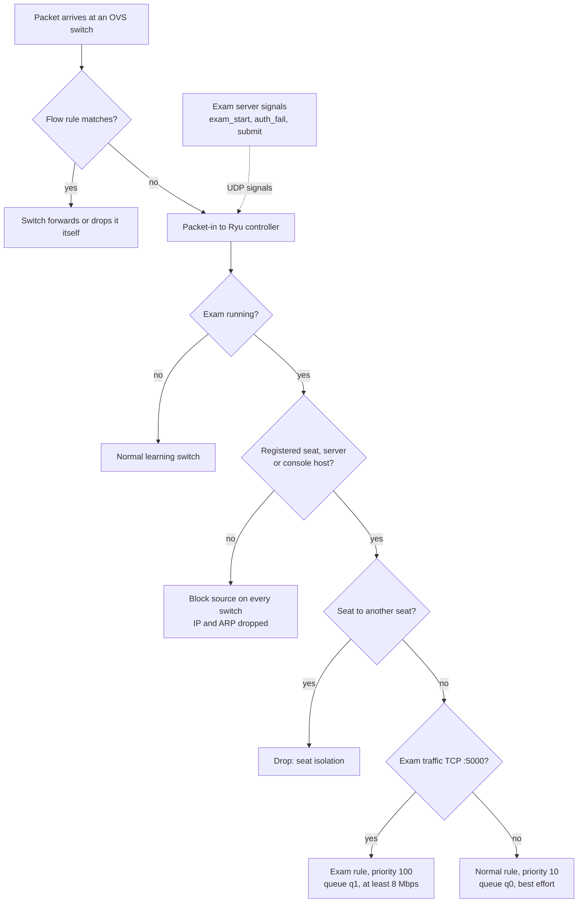
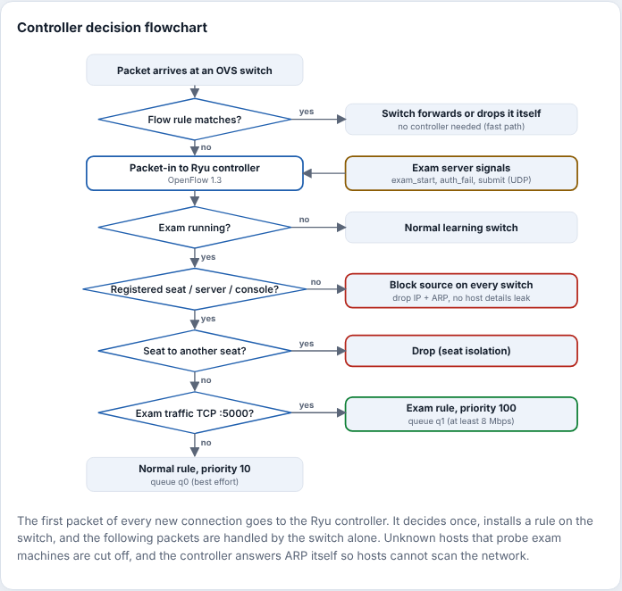
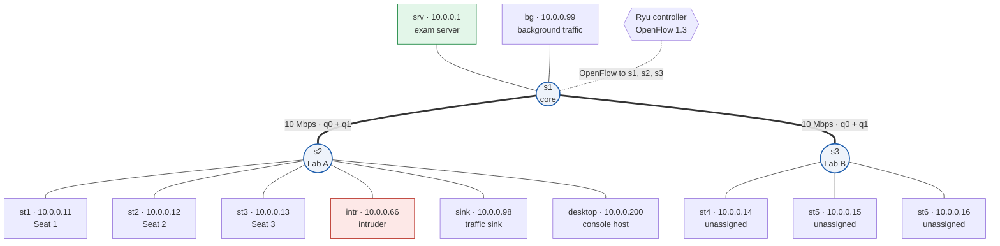
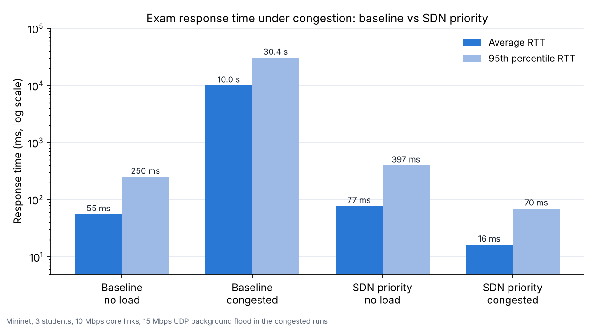
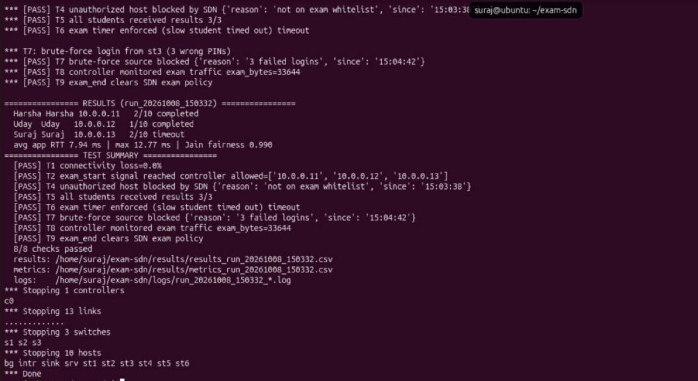
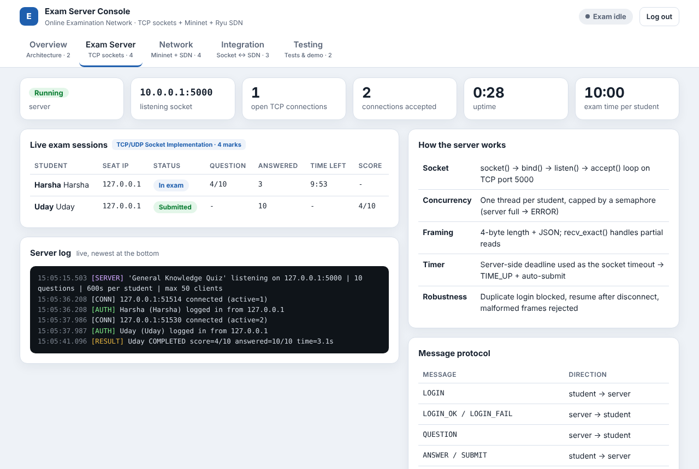
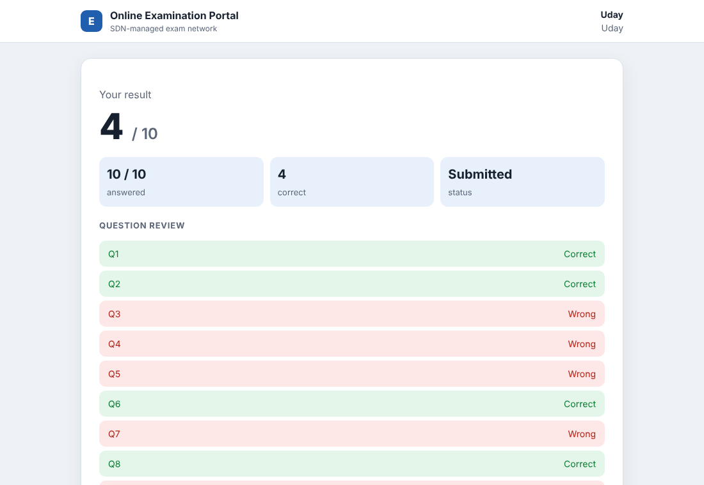

# SDN Online Examination Network

**A multi-user online exam over raw TCP sockets, running on an SDN network that understands the exam.**


Students take a timed multiple-choice exam that runs over TCP sockets. The exam runs inside a Mininet network whose switches are programmed by our own Ryu controller. The exam server tells the controller what is happening (the exam started, a login failed, a student submitted), and the controller changes the network rules to match. It lets registered seats through, blocks intruders and password guessers, gives exam traffic a guaranteed-bandwidth queue, and monitors all traffic.

Built as a computer networks mini project (*SDN + Socket Programming, Problem #18: Online Examination Network*).

<p align="center">
  
</p>

---

## Contents

- [Objectives](#objectives)
- [Functionality](#functionality)
- [Highlights](#highlights)
- [Architecture](#architecture)
- [How the application and the network interact](#how-the-application-and-the-network-interact)
- [Security: keeping host details away from intruders](#security-keeping-host-details-away-from-intruders)
- [Getting started](#getting-started)
- [Running the demo](#running-the-demo)
- [Testing](#testing)
- [Results and screenshots](#results-and-screenshots)
- [Configuration](#configuration)
- [Project structure](#project-structure)
- [Documentation](#documentation)
- [Team contributions](#team-contributions)
- [License](#license)

## Objectives

1. Deliver a timed online exam to many students at once over **TCP sockets**, with a clear application protocol: login, questions, answers, a server-side timer and results.
2. Build an **SDN network** in Mininet with a Ryu controller that knows when an exam is running, from events sent by the application.
3. Enforce exam policy in the network: only registered seats reach the exam server, intruders and brute-force sources are blocked, and exam traffic is prioritised.
4. **Monitor** exam traffic against background traffic and detect congestion.
5. Measure **response time and fairness** (Jain's index) and compare SDN prioritisation with a baseline.

## Functionality

| Feature | What it does |
|---|---|
| Concurrent TCP clients | One thread per student; a semaphore caps the load |
| Question delivery | Questions sent one at a time; the answer key never leaves the server |
| Answer submission | Answers are validated per question; submit at any time |
| Exam timer | Enforced by the server (socket timeout = time left), auto-submit on `TIME_UP` |
| Results | Automatic grading, result and question review for the student, CSV for the examiner |
| Resume | A dropped student logs back in and continues with the same deadline |
| Seat whitelist (SDN) | Unregistered hosts are dropped at their first packet |
| Brute-force block (SDN) | 3 wrong passwords block that seat's IP on every switch |
| Host-discovery protection (SDN) | Unregistered hosts that ping, ARP-scan or connect to exam machines are cut off; proxy ARP and seat isolation hide hosts from each other |
| Hidden host details (app) | Public pages show only seat numbers: no IP addresses, host names, server address or student names |
| QoS (SDN) | Exam flows use a queue with at least 8 Mbps guaranteed on the bottleneck links |
| Traffic monitoring (SDN) | Exam and background bytes counted every 5 s; congestion events |
| Student portal | Web page on each seat: login, countdown, one question at a time, result |
| Server Console | Password-protected dashboard: sessions, topology, flow tables, events, live checks |
| Public access | Optional Cloudflare links so students can join from phones |

## Highlights

**Exam application (TCP sockets, Python standard library only)**
- Concurrent server: one thread per student, capped by a semaphore, with a clean "server full" error
- Length-prefixed JSON protocol (4-byte length + JSON) and a `recv_exact` loop that handles partial reads
- Login, one question at a time, answer key kept on the server, automatic grading and a CSV of results
- Timer enforced by the server, using the remaining time as the socket timeout, with `TIME_UP` and auto-submit
- Resume after a disconnect with the original deadline; duplicate logins and re-submissions rejected
- Round-trip time measured for every request, and Jain's fairness index computed across students

**SDN network (Ryu, OpenFlow 1.3, Mininet, Open vSwitch)**
- Campus-style topology: a core switch and two lab switches, with 10 Mbps bottleneck core links
- Exam mode driven by events from the application, not by static configuration
- Seat whitelist: a host not assigned to the exam is dropped at its first TCP SYN
- Brute-force protection: after 3 failed logins the source IP is blocked on every switch
- Exam flows placed in a guaranteed queue (at least 8 Mbps) while other traffic stays best-effort
- Flow and port statistics every 5 s, split into exam and background bytes, with congestion detection
- REST API for status, statistics, flow tables, events and manual block/unblock

**Web layer (HTTP written on raw sockets, no framework)**
- Student portal on every seat host: login, live countdown, auto-submit, result with a review of each question
- Server Console for examiners: password protected, with live sessions, topology, flow tables, the app-to-SDN event timeline and system checks
- Optional public access: free Cloudflare Quick Tunnels plus a seat-picking gateway, so classmates can join from their phones

## Architecture



Every student portal runs **on its seat host inside Mininet**, so each exam connection really comes from that seat's IP address and crosses the SDN switches. That is what makes the whitelist, the blocking and the priority queues meaningful.

### Controller decision flowchart



The controller sees only the first packet of each new connection. It decides once and installs a rule, and the switch handles the rest of the connection on its own.

<p align="center">
  
</p>

### Network topology



Host links run at 100 Mbps; the two core links are limited to 10 Mbps so congestion can be created on purpose. Each core link has two queues: **q0** best effort and **q1** for exam traffic (at least 8 Mbps).


## How the application and the network interact

The exam server sends small JSON datagrams to the virtual address `10.0.0.254:6666`. A priority-400 rule on every switch hands them to the controller, which also answers ARP for that address itself. Signals carry a shared token, and every event except `exam_start` is accepted only from the registered server IP.

| Application event | Controller reaction |
|---|---|
| `exam_start` (server IP, port, allowed seats; repeated as a heartbeat) | Enter exam mode, store the whitelist, flush old flows so new ones get queues; a new run id resets per-exam state |
| First SYN to the exam port from a non-whitelisted IP | Install a priority-300 drop rule on all switches |
| `auth_fail` with count ≥ 3 | Block that source IP |
| `student_login` / `student_submit` | Track active students and results |
| `exam_end` | Leave exam mode; remove blocks and queue assignments |

**Flow table**

| Priority | Cookie | Match | Action |
|---|---|---|---|
| 400 | `0xE4` | UDP to 10.0.0.254:6666, ARP for 10.0.0.254 | to controller |
| 310 | `0xE3` | blocked source → console host (IP, ARP) | to controller |
| 300 | `0xE3` | blocked source (all IP and ARP) | drop |
| 300 | `0xE3` | seat → another seat | drop |
| 100 | `0xE1` | exact TCP 5-tuple on port 5000 | `set_queue:1`, output |
| 10 | `0xE2` | other IPv4 5-tuple | `set_queue:0`, output |
| 5 | `0xE5` | L2 (ARP and others) | output |
| 0 | — | table-miss | to controller |

## Security: keeping host details away from intruders

An intruder, meaning any host or person that is not part of the exam, should not learn which machines exist, what their addresses are or who is taking the exam. This is enforced at two levels.

**In the network (Ryu controller, while an exam is running)**

| Protection | How it works |
|---|---|
| Host-discovery protection | A host that is not a registered seat, the exam server or the console host is blocked the moment it sends an ARP request or any IP packet to an exam machine. Ping sweeps, ARP scans and port scans get no answer. |
| Full isolation of blocked hosts | A blocked host loses all IP and ARP traffic on every switch (priority 300). The only exception is the console host (priority 310), so its page can still show "cannot reach the exam server". |
| Proxy ARP | The controller answers ARP requests for known hosts itself instead of broadcasting them, so hosts do not see each other's ARP traffic. |
| Seat isolation | Registered seats can reach the exam server but not each other. Students cannot discover or connect to other students' machines. |
| Authenticated signals | App-to-controller signals carry a shared token (`EXAM_SDN_TOKEN`) and, apart from `exam_start`, are accepted only from the exam server's IP. |

**In the application (public web pages)**

| Protection | How it works |
|---|---|
| No addresses on public pages | The seat picker, the gateway banner and the exam page show only "Seat 1, 2, 3". No IP addresses, host names or exam-server address appear in the HTML or the JSON APIs. |
| No student names | Seats no longer say who they are reserved for, and the username is not pre-filled, so an outsider cannot collect usernames to guess passwords. |
| Generic errors | Connection errors no longer include addresses or system error text. |
| HTTP hardening | Every response sends `X-Content-Type-Options: nosniff`, `X-Frame-Options: DENY`, `Referrer-Policy: no-referrer` and `Cache-Control: no-store`. |
| Examiner-only details | Full host details remain available only on the password-protected Server Console. |

Settings: `EXAM_ISOLATE=0` turns the network protections off, for comparison. `EXAM_MGMT_IPS` sets the console host or hosts (default `10.0.0.200`).

## Getting started

**Requirements:** Ubuntu 22.04, 24.04 or 26.04, on a VM or bare metal, with sudo access. Tested on Ubuntu 26.04 in VirtualBox.

```bash
git clone https://github.com/SurajCB/SDN-Online-Examination-Network.git
cd SDN-Online-Examination-Network
./scripts/install.sh
```

`install.sh` installs Mininet, Open vSwitch, iperf and qrencode, plus `cloudflared` for the optional public links. Ryu does not run on recent Python releases, so the script creates a separate Python 3.9 environment at `~/ryu-venv` (using `uv`) and pins `setuptools==67.6.1`, `eventlet==0.30.2` and `dnspython<2`. `run_controller.sh` activates that environment automatically.

The exam application itself only needs the Python standard library.

## Running the demo

Use three terminals, all in the repository folder.

```bash
# Terminal 1: SDN controller
./scripts/run_controller.sh

# Terminal 2: Mininet network, exam server, seat portals and Server Console
./scripts/run_portal.sh            # prints the console password, then the mininet> prompt

# Terminal 3 (optional): public links for phones
./scripts/run_public.sh            # prints the student link, console link and a QR code
```

Without the public links, open Firefox on the Ubuntu desktop:

| URL | What |
|---|---|
| `http://localhost:9000` | Server Console (password from Terminal 2, also in `logs/console_password.txt`) |
| `http://10.0.0.11:8000` … `10.0.0.13:8000` | Seats of the three demo students |
| `http://10.0.0.66:8000` | Intruder seat: the SDN blocks it |

**Demo accounts** (sample data in `data/students.json`, for demonstration only):

| Username | Password | Seat |
|---|---|---|
| Harsha | `Harsha@123` | st1 · 10.0.0.11 |
| Uday | `Uday@123` | st2 · 10.0.0.12 |
| Suraj | `Suraj@123` | st3 · 10.0.0.13 |

**Stopping:** type `exit` at `mininet>` and press `Ctrl+C` in the other terminals. If something is left over, run `./scripts/cleanup_net.sh`. Avoid `sudo mn -c` while the controller is running, because it also kills Ryu.

<details>
<summary><b>Running it by hand in the Mininet CLI</b></summary>

```bash
sudo python3 topology/exam_topo.py --cli
mininet> srv python3 app/exam_server.py --duration 180 &
mininet> st1 python3 app/exam_client.py --id Harsha --pin 'Harsha@123'          # interactive
mininet> st2 python3 app/exam_client.py --id Uday --pin 'Uday@123' --auto       # automatic
mininet> intr python3 app/exam_client.py --id Harsha --pin 'Harsha@123'         # blocked
mininet> sh ovs-ofctl -O OpenFlow13 dump-flows s1
$ curl localhost:8080/exam/status
```
</details>

## Testing

```bash
python3 tests/test_local.py                                       # 14 tests, no Mininet needed
~/ryu-venv/bin/python tests/test_controller.py                    # 17 controller tests with a mocked switch
./scripts/run_demo.sh                                             # end-to-end Mininet run with PASS/FAIL checks
```

| Check | Scenario | Pass condition |
|---|---|---|
| T1 | `pingall` | 0 % loss |
| T2 | Exam server starts | Controller reports `exam_active` with the whitelist |
| T3 / T5 | Three clients at once | All connect, finish and get a result |
| T4 | Client on the intruder host | Dropped by the SDN, listed as blocked |
| T6 | Slow student | Server times them out |
| T7 | Three wrong passwords | Source IP blocked |
| T8 | Monitoring | Exam bytes counted by the controller |
| T9 | Exam ends | Exam mode off, blocks removed |
| T10 | Unassigned host st4 pings a seat and the server | No replies; st4 blocked on its first probe |
| T11 | st1 pings st2 | Dropped by the controller; `seat_isolation` event logged |

Unit tests run on every push through GitHub Actions (`.github/workflows/tests.yml`).

## Results and screenshots

### Performance evaluation (D2)

Four runs in Mininet on Ubuntu 26.04 (VirtualBox), each with three students. The third student is deliberately slow (8–10 s per answer) so the server timer is exercised. In the congested runs, a 15 Mbps UDP flood is sent over the 10 Mbps core link that the exam traffic crosses.

| Run | Priority queues | Background flood | Avg RTT | p95 RTT | Max RTT | Jain | What happened to the students | Checks |
|---|---|---|---|---|---|---|---|---|
| `base_idle` | off | none | 55.2 ms | 249.8 ms | 458.4 ms | 0.807 | 2 completed, slow student timed out (as designed) | 10/10 |
| `base_cong` | off | 15 Mbps | **9,961 ms** | **30,448 ms** | **45,370 ms** | 0.874 | **Nobody completed**: one disconnected, one ran out of time after 6 requests, one never got a single reply | 9/10 |
| `sdn_idle` | on | none | 76.9 ms | 396.9 ms | 1,021.8 ms | 0.626 | 2 completed, slow student timed out (as designed) | 10/10 |
| `sdn_cong` | on | 15 Mbps | **16.2 ms** | **69.6 ms** | **171.7 ms** | 0.695 | 2 completed in 8–11 s, slow student timed out (as designed) | 9/10 → 10/10 on recheck |

<p align="center">
  
</p>

**What the numbers show**

- **Under congestion, SDN prioritisation keeps the exam usable.** Without priority queues, exam packets share the flooded queue: the average response time rose to about 10 s, the 95th percentile to 30 s, and no student could finish normally. With the controller putting exam flows into the guaranteed queue (q1, at least 8 Mbps), the average was 16 ms, about 600 times lower, and the 95th percentile was 70 ms.
- **On an idle network, priority makes no meaningful difference.** Both idle runs stayed below 100 ms on average. The gap between them comes from VM timing noise and the slow student's occasional spikes (maximum 458 ms and 1,022 ms), not from the queues.
- **Fairness.** Jain's index is computed over the three students' average response times. Because one of the three is deliberately slow, it mostly reflects that student's spikes. Response time and completion are the clearer measures in this setup.
- **Checks T1–T10 passed in every run.** T11 failed in the two congested runs because its original version also pinged the server, and ICMP is best-effort traffic that the flood drops. Seat isolation itself worked. T11 now checks the controller's `seat_isolation` event instead. A recheck with SDN priority and congestion passed **10/10** (average 16.6 ms, maximum 233 ms, Jain 0.792).

The raw files are in [docs/results/](docs/results): per-student metrics CSVs, test summaries and the `analyze.py` output. To reproduce, see [Performance experiments](docs/TEST_PLAN.md).

### D1 run

The first end-to-end run (SDN priority, no congestion, T1–T9) passed **8 / 8** checks, with an average response time of 7.94 ms, a maximum of 12.77 ms and Jain fairness of 0.990.

<p align="center">
  
</p>

### Screenshots

<p align="center">
  
  
</p>
<p align="center">
  
</p>
<p align="center"><sub>Console and result screenshots come from a local preview run, so seat addresses show as 127.0.0.1.</sub></p>

## Configuration

| Component | Option | Default |
|---|---|---|
| Exam server | `--duration`, `--max-clients`, `--shuffle`, `--strict-seat`, `--no-sdn` | 120 s (600 s in portal mode), 50 clients |
| Controller (env) | `EXAM_PRIORITIZE` (0 = baseline), `EXAM_CONGESTION_MBPS`, `EXAM_BLOCK_THRESHOLD`, `EXAM_MONITOR_INTERVAL` | 1, 5, 3, 5 s |
| Signalling (env) | `EXAM_SDN_TOKEN`: shared secret between server and controller | demo value; change it for real use |
| Security (env) | `EXAM_ISOLATE` (0 = off), `EXAM_MGMT_IPS` (console host) | 1, 10.0.0.200 |
| Server Console (env) | `EXAM_CONSOLE_PASSWORD` | random, printed at start |
| Topology | `--demo`, `--portal`, `--cli`, `--congestion`, `--bg-rate`, `--core-bw`, `--no-qos`, `--tag` | 10 Mbps core links |

**Controller REST API** (port 8080): `GET /exam/status`, `/exam/stats`, `/exam/flows`, `/exam/events`; `POST /exam/block/<ip>`, `/exam/unblock/<ip>`, `/exam/start`, `/exam/end`.

## Project structure

```
SDN-Online-Examination-Network/
├── app/
│   ├── protocol.py          # framing: 4-byte length + JSON, recv_exact
│   ├── exam_server.py       # concurrent TCP exam server, timer, grading
│   ├── exam_client.py       # terminal client (interactive or --auto)
│   ├── sdn_signal.py        # application → controller UDP signals
│   ├── minihttp.py          # small HTTP/1.1 server on raw sockets
│   ├── student_portal.py    # seat portal: HTTP ↔ TCP exam protocol
│   ├── gateway.py           # public seat picker / reverse proxy
│   ├── admin_portal.py      # Server Console backend
│   └── web/                 # student.html, seats.html, console.html
├── controller/exam_controller.py   # Ryu app: policy, queues, monitoring, REST
├── topology/exam_topo.py           # Mininet topology, QoS, demo and portal modes
├── data/                    # questions.json, students.json (demo data)
├── scripts/                 # install, run_*, cleanup_net, status
├── tests/                   # test_local.py, test_controller.py
├── tools/analyze.py         # RTT and Jain fairness analysis
└── docs/                    # architecture, test plan, team plan, images
```

## Documentation

- [docs/ARCHITECTURE.md](docs/ARCHITECTURE.md): problem, objectives, protocol, session state machine, flow-table design
- [docs/TEST_PLAN.md](docs/TEST_PLAN.md): unit tests, Mininet scenarios, web portal checks, performance experiments

## Team contributions

| Member | Role | Contributions |
|---|---|---|
| **Uday** (Member 1) | Application lead | TCP exam server (`exam_server.py`): concurrency, sessions, timer, grading and results; message protocol (`protocol.py`); terminal client (`exam_client.py`); HTTP server on raw sockets (`minihttp.py`); student portal and exam page (`student_portal.py`, `student.html`); question bank and student accounts |
| **Harsha** (Member 2) | Network lead | Mininet topology with campus layout, bottleneck links and OVS QoS queues (`exam_topo.py`); Ryu SDN controller (`exam_controller.py`): flow-table design, seat whitelist, blocking, queue selection, traffic monitoring and REST API; installation script |
| **Suraj CB** (Member 3) | Integration & QA lead | App-to-SDN signalling (`sdn_signal.py`); Server Console (`admin_portal.py`, `console.html`); public gateway and Cloudflare links (`gateway.py`, `run_public.sh`); automated Mininet demo and test checks; unit tests; performance analysis (`analyze.py`); documentation and repository |

## Notes

- `data/students.json` contains **sample demo accounts only**. Never commit real student credentials.
- Quick Tunnel links are temporary, change every time they start and come with no uptime guarantee. Some campus networks block them, so a phone hotspot works as a fallback.
- This project was built for teaching and demonstration. It is not a hardened exam platform.

## License

Released under the [MIT License](LICENSE).
